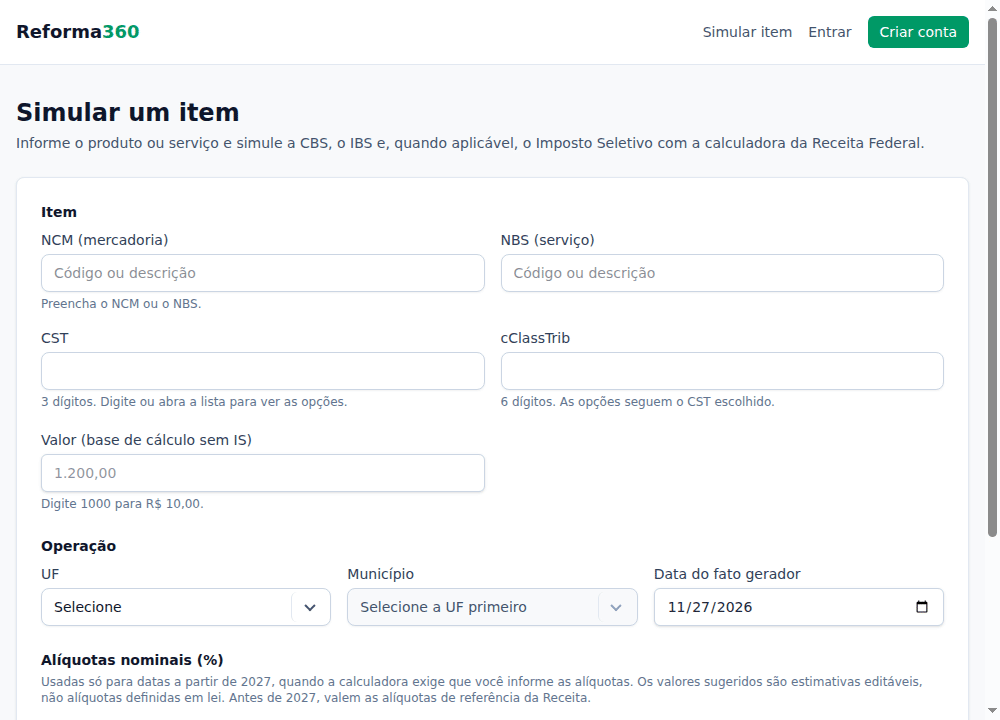
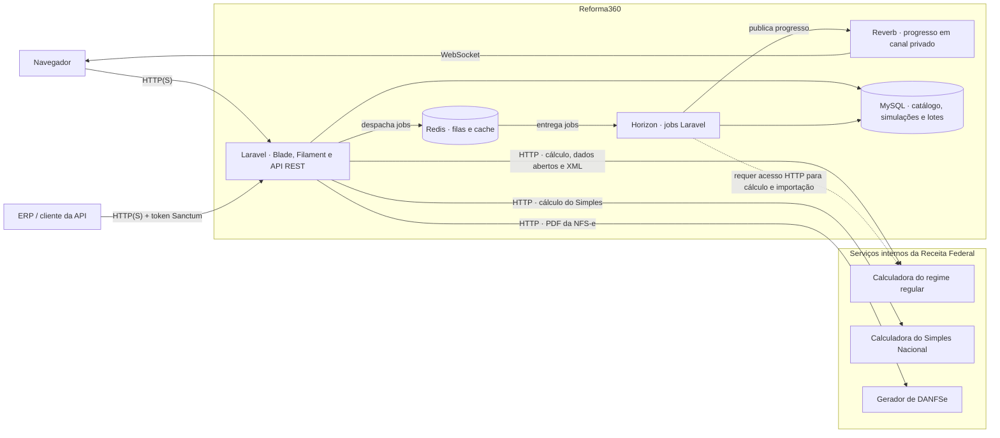

# Reforma360

[](https://github.com/MatheusSaleh/reforma360/actions/workflows/ci.yml)


[](#licença)

Simulador da Reforma Tributária do Consumo (CBS/IBS — LC 214/2025) para pequenas empresas e contadores, construído em **Laravel** sobre a [Calculadora de Tributos open source da Receita Federal](https://github.com/ReceitaFederal).

> Os resultados são **simulações** e não substituem a orientação de um contador.

## Visão geral

O Reforma360 permite cadastrar ou importar produtos e serviços, simular CBS, IBS e, quando aplicável, o Imposto Seletivo, visualizar a transição de 2026 a 2033 e comparar o Simples Nacional com a opção pelo regime regular de IBS/CBS.

### Demonstração

O GIF mostra a simulação de um serviço de educação, do preenchimento do formulário ao detalhamento de CBS e IBS. A gravação usa dados fictícios e uma resposta de exemplo da calculadora.



### Entrada de dados

1. **Cadastro manual** de produtos e serviços com descrição, preço e busca por NCM ou NBS nos dados abertos da calculadora.
2. **Importação de planilha CSV/XLSX**, com validação linha a linha.
3. **Importação de XML de NF-e, NFC-e e NFS-e** para extrair os itens do documento. Para NF-e e NFC-e, o app gera o XML do grupo IBS/CBS a partir da simulação e o valida contra o XSD da Receita. O DANFSe em PDF é gerado a partir da NFS-e original.

### Funcionalidades

- Simulação em lote com filas (`Bus::batch()`) e progresso em tempo real (Reverb)
- Linha do tempo 2026→2033 por item
- Comparador Simples × regime regular de IBS/CBS
- Relatório em PDF
- Painel admin com Filament
- API pública com Sanctum e documentação com Scribe
- Testes com Pest e CI no GitHub Actions

## Arquitetura



O Laravel concentra o catálogo, a orquestração dos cálculos e a apresentação dos resultados. As integrações HTTP ficam em `App\Integrations\Calculadora`. Os serviços da Receita rodam com o código upstream, sem portas publicadas no host.

### Decisões de arquitetura

- [ADR 0001 — Processar simulações em filas com lotes do Laravel](docs/adr/0001-simulacoes-em-lote.md)
- [ADR 0002 — Consumir as calculadoras da Receita como serviços internos sem fork](docs/adr/0002-calculadoras-sem-fork.md)
- [ADR 0003 — Usar Strategy para os importadores de catálogo](docs/adr/0003-importadores-strategy.md)

| Serviço | Repositório upstream | Stack |
|---|---|---|
| Regime regular | [calculadora-rtc-regime-regular](https://github.com/ReceitaFederal/calculadora-rtc-regime-regular) | Java 25, Spring Boot 4, SQLite |
| Simples Nacional | [calculadora-rtc-simples-nacional](https://github.com/ReceitaFederal/calculadora-rtc-simples-nacional) | Java 25, Spring Boot 4, SQLite |
| DANFSe | [calculadora-rtc-gerador-danfse](https://github.com/ReceitaFederal/calculadora-rtc-gerador-danfse) | Go, Echo |

## Como desenvolver

### Pré-requisitos

- Docker e Docker Compose
- PHP 8.4+ e Composer (opcional se usar Laravel Sail)
- Node.js 22+ (assets do front)
- Git

### 1. Clonar o projeto

```bash
git clone https://github.com/MatheusSaleh/reforma360.git
cd reforma360
```

### 2. Calculadoras da Receita

As calculadoras ficam em `services/`, clonadas do upstream (não versionadas aqui, para facilitar a atualização). O script clona na primeira vez e atualiza nas seguintes:

```bash
./scripts/calculadoras-clone.sh
```

O `compose.yaml` sobe, junto com o Laravel:

| Serviço | O que faz | Healthcheck |
|---|---|---|
| `calculadora-db` | Execução única: gera/atualiza o SQLite com `flyway:migrate` (scripts do regime regular) no volume `calculadora-db` | termina com código 0 |
| `calculadora-regular` | API do regime regular (Java 25) | `GET /api/calculadora/dados-abertos/versao` |
| `calculadora-simples` | API do Simples Nacional (Java 25) | `GET /api/versao` |
| `danfse` | Gerador de DANFSe (Go) | `GET /health/ready` |

- As duas APIs Java usam o **mesmo banco**, montado como somente leitura. A documentação do Simples orienta usar os scripts Flyway do regime regular.
- As calculadoras ficam na rede interna `calculadoras` (`internal: true`), **sem porta publicada no host**. No Compose versionado, `laravel.test` participa dessa rede. Para processar jobs que consultam a calculadora, o serviço `horizon` também precisa participar das redes `sail` e `calculadoras`.
- A imagem das APIs Java é construída por [`docker/calculadora-java/Dockerfile`](docker/calculadora-java/Dockerfile) a partir do código upstream; o DANFSe usa o Dockerfile do próprio repositório.

O primeiro `sail up` demora (build Maven/Go e geração do banco). Para conferir de dentro da rede:

```bash
./vendor/bin/sail ps
./vendor/bin/sail exec -u sail laravel.test curl -fsS http://calculadora-regular:8080/api/calculadora/dados-abertos/versao
```

Depois de atualizar o upstream (`./scripts/calculadoras-clone.sh`), reconstrua as imagens e rode as migrações do banco:

```bash
./vendor/bin/sail build calculadora-regular calculadora-simples danfse
./vendor/bin/sail up -d
```

### 3. Aplicação Laravel

O ambiente usa [Laravel Sail](https://laravel.com/docs/sail) (`compose.yaml`) com MySQL 8.4 e Redis:

```bash
cp .env.example .env
composer install
./vendor/bin/sail up -d
./vendor/bin/sail artisan key:generate
./vendor/bin/sail artisan migrate --seed   # cria o usuário demo@reforma360.test (senha: password)
./vendor/bin/sail npm install && ./vendor/bin/sail npm run dev
```

> Se as portas 80, 3306 ou 6379 já estiverem em uso, defina `APP_PORT`, `FORWARD_DB_PORT` e `FORWARD_REDIS_PORT` no `.env`.

Variáveis de ambiente das calculadoras:

```dotenv
CALCULADORA_REGIME_REGULAR_URL=http://calculadora-regular:8080/api
CALCULADORA_SIMPLES_URL=http://calculadora-simples:8080/api
DANFSE_URL=http://danfse:8080/api
```

### 4. Filas e tempo real

O `compose.yaml` sobe junto com o `sail up`:

- **`horizon`**: processa as filas (`simulacoes`, `importacoes`, `default`). Painel em [`/horizon`](http://localhost/horizon) (em produção, só para administradores).
- **`scheduler`**: tarefas agendadas (`routes/console.php`), como apagar os XMLs de NFS-e guardados além da retenção (`IMPORTACAO_RETENCAO_XML_DIAS`, padrão 30 dias).
- **`reverb`**: WebSocket do progresso em tempo real, na porta `8080` do host (`FORWARD_REVERB_PORT`). O Laravel fala com ele pela rede do Docker (`REVERB_HOST=reverb`); o navegador, por `VITE_REVERB_HOST=localhost`.

Depois de mudar código de jobs ou eventos, reinicie os workers:

```bash
./vendor/bin/sail restart horizon reverb
```

E-mails vão para `storage/logs/laravel.log` em desenvolvimento (`MAIL_MAILER=log`).

### Painel admin

Painel Filament em [`/admin`](http://localhost/admin) para administradores da plataforma: empresas, usuários, jobs com falha e métricas de uso. Para dar acesso a um usuário (vale também para o `/horizon` em produção):

```bash
./vendor/bin/sail artisan reforma360:tornar-admin email@exemplo.com          # promove
./vendor/bin/sail artisan reforma360:tornar-admin email@exemplo.com --remover
```

### API pública

API REST em `/api/v1` para integrar ERPs e outros sistemas: simular um item na hora, gerenciar o catálogo e simular o catálogo inteiro em lote. Documentação em [`/docs`](http://localhost/docs) (com Postman e OpenAPI).

1. No app, abra **API** (`/conta/tokens`), dê um nome ao token e escolha as permissões (`produtos:ler`, `produtos:escrever`, `simulacoes`). O token aparece uma única vez.
2. Envie no cabeçalho `Authorization: Bearer <token>`:

```bash
curl -X POST http://localhost/api/v1/simulacoes/item \
  -H "Authorization: Bearer $TOKEN" -H "Accept: application/json" -H "Content-Type: application/json" \
  -d '{"nbs":"122011200","cst":"200","c_class_trib":"200028","valor":"1200.00","uf":"RS","municipio":"4314902","data":"2027-03-10","aliquota_cbs":"8.8","aliquota_ibs_estadual":"0.05","aliquota_ibs_municipal":"0.05"}'
```

Limites por token em `API_LIMITE_POR_MINUTO` (padrão 60) e `API_LIMITE_SIMULACOES_POR_MINUTO` (padrão 20). Depois de mudar endpoints, regenere a documentação com `./vendor/bin/sail artisan scribe:generate`.

### 5. Testes e qualidade

```bash
composer test      # Pest (SQLite em memória)
composer analyse   # Larastan nível 8
composer lint      # Pint (--test); `composer format` corrige
```

A CI ([`.github/workflows/ci.yml`](.github/workflows/ci.yml)) roda em todo PR e push na `main`: Pest em PHP 8.4 e 8.5 (cobertura mínima de 90% no 8.5, com o total no resumo da execução), Larastan nível 8 e Pint.

## Fluxo de trabalho

- Cada tarefa é uma issue, agrupada por milestone (Semana 1 a 4).
- Branches: `feat/<numero-issue>-descricao`, `fix/...`, `chore/...`.
- Commits no padrão [Conventional Commits](https://www.conventionalcommits.org/pt-br/).
- PR para `main` com CI verde (Pest, Larastan, Pint).

## Roadmap

1. **Semana 1:** Docker com as calculadoras, client HTTP e simulação de um item.
2. **Semana 2:** cadastro manual com autocomplete de NCM, importação CSV/XLSX e lote com filas.
3. **Semana 3:** upload de XML, validação XSD, DANFSe, comparador e PDF.
4. **Semana 4:** testes, CI, deploy com dados de demonstração e README final.

## Cuidados conhecidos

- A calculadora só tem alíquotas de referência para 2026. A partir de 2027 as alíquotas nominais são **entrada obrigatória** (`aliquotasNominais`): o simulador sugere estimativas editáveis (`config/simulacao.php`) e o resultado sai como `CALCULO_SIMULADO`.
- O retorno da API marca os itens como `CALCULO_SIMULADO`.
- O Simples Nacional não tem scripts Flyway próprios: o banco é gerado com os do regime regular e compartilhado pelas duas APIs (serviço `calculadora-db`).

## Licença

MIT. As calculadoras da Receita Federal também são distribuídas sob licença MIT.
